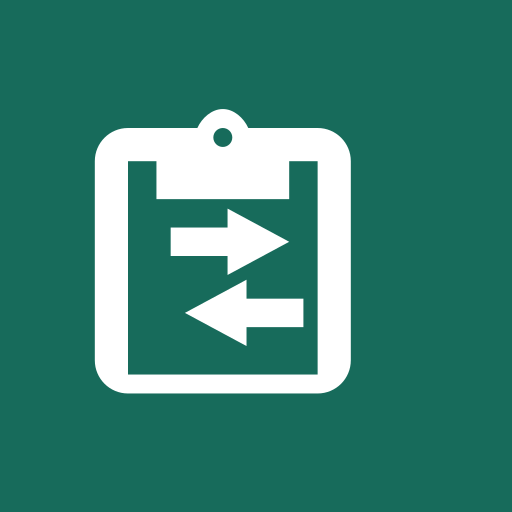
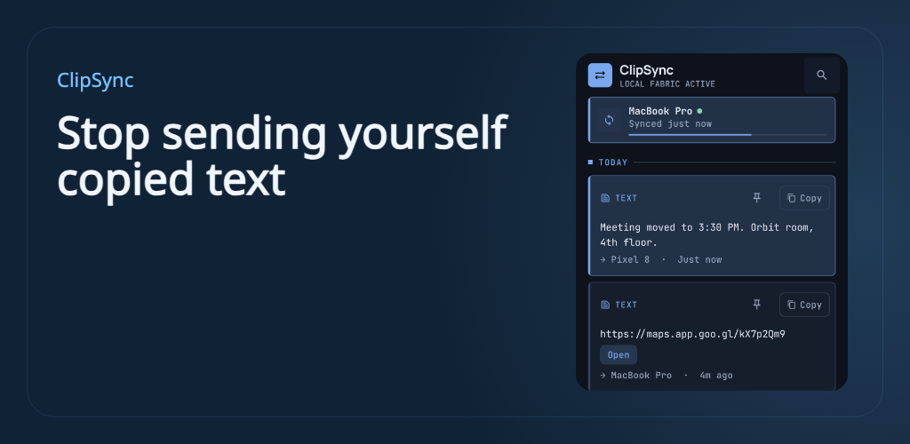
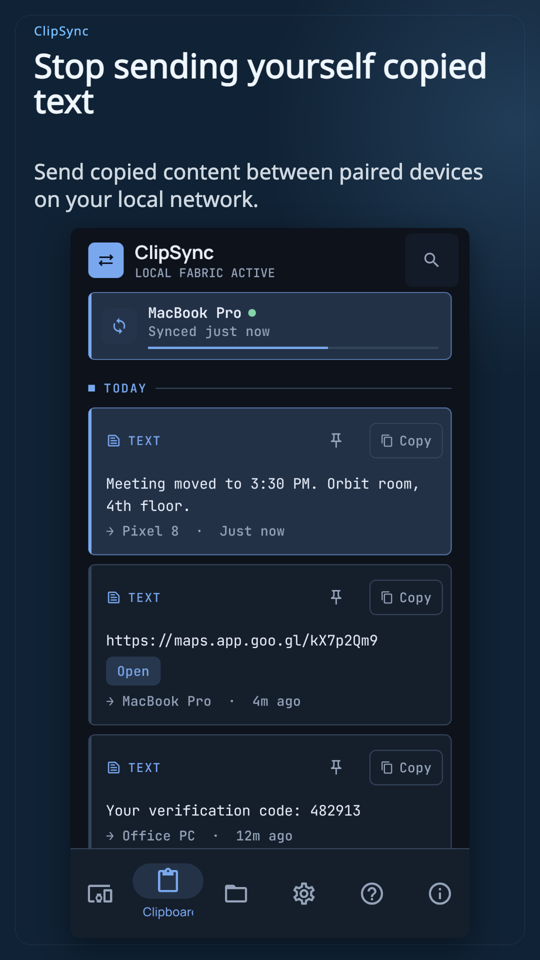
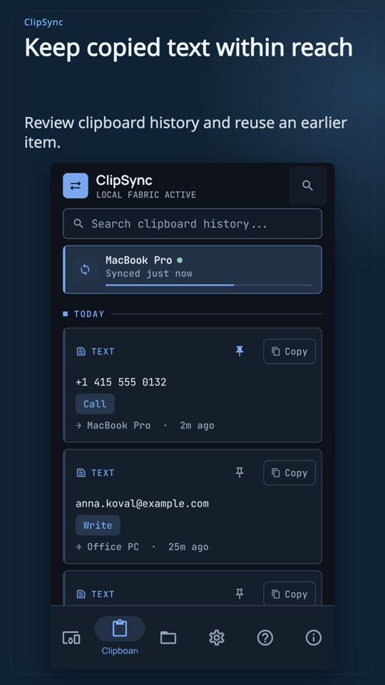
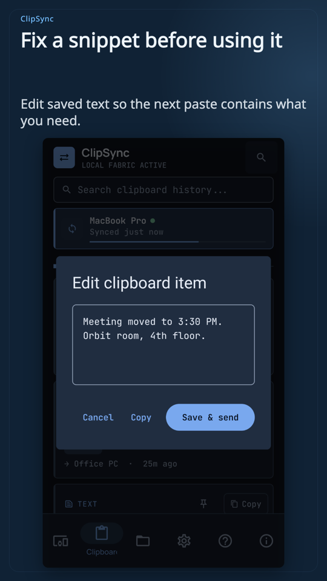
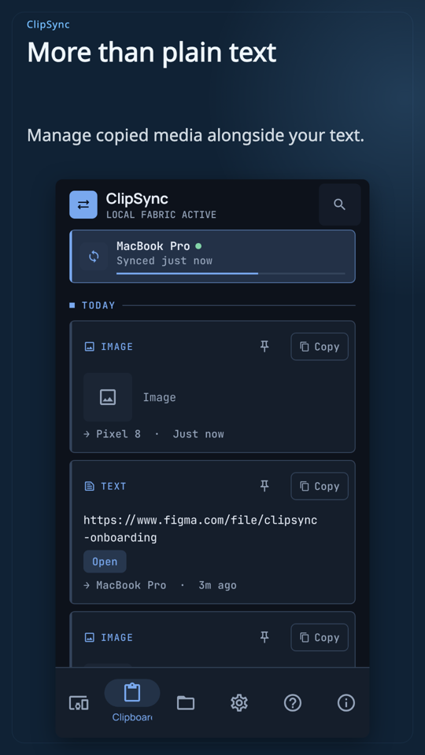

  

<h1 align="center">ClipSync</h1>

  <b>Your Android phone on Linux, Windows and macOS — over your own Wi‑Fi.</b> 
  Clipboard · files · notifications · calls · media · photos · screen mirroring. 
  No account. No cloud. No ads.

  <a href="https://osvald-studio.com/clipsync">Website</a> ·
  <a href="https://osvald-studio.com/download">Download</a> ·
  <a href="https://osvald-studio.com/buy">Buy once — $19</a> ·
  <a href="docs/INSTALL.md">Install &amp; activate</a> ·
  <a href="docs/FAQ.md">FAQ</a> ·
  <a href="README.uk.md">Українською</a>

  

---

## What it does

| | |
|---|---|
| **One clipboard, every device** | Copy on the phone, paste on the computer — and back. Text, rich text, links and images. Works with **several** paired devices at once. |
| **Files both ways** | Share from any Android app, drop a file on the computer. Transfers resume after a dropped connection and are verified with SHA‑256. |
| **Secrets** | Passwords from a password manager travel as *secrets*: memory only, never in history, cleared from the clipboard after 45 s. |
| **Notifications on the computer** | See phone notifications on Linux, Windows or Mac — reply, tap actions, dismiss. |
| **Calls** | See who is calling, answer, decline or hang up from the computer; dial from `tel:` links. Audio stays on the phone. |
| **Media control both ways** | Play / pause / next for what plays on the phone, and control Spotify or MPRIS players on the computer from the phone. |
| **Phone photos on the big screen** | Browse, preview and save your phone's gallery from the computer. |
| **Screen mirroring** | Your phone's screen in a window, with sound, and optional mouse and keyboard control. |
| **Find my phone · Open link on the other device** | Ring the phone even on silent; send a link to open on the other device. |

     

## Platforms

| Android | Linux | Windows | macOS |
|---|---|---|---|
| Android 8.0+ (APK, no Google services required) | AppImage / .deb, tray, autostart, MPRIS | Installer / portable | Menu‑bar app, macOS 13+ |

Devices find each other on the local network (Bonjour / DNS‑SD and a UDP probe) and appear under their names.
Same Wi‑Fi is required by design — there is no relay server.

## Privacy and security

- No account, no server in the middle, no analytics, no telemetry.
- Pairing shows a **6‑digit code on both screens** (SAS); approve only if the codes match.
- Everything between devices is end‑to‑end encrypted per pair (ECDH P‑256 + AES‑256‑GCM). Screen mirroring has its own per‑session key.
- Keys live in Android Keystore, macOS Keychain, Windows DPAPI or the Linux Secret Service.
- Logs never contain clipboard content, notification text, phone numbers or file names of secrets.

## Pricing

ClipSync is free to try. One license key — **$19, paid once** — unlocks the full feature set on **all your devices** (up to 5) for as long as you use it. Payment in USDC on the Base network, no card and no account required. Buy on the [website](https://osvald-studio.com/buy); the key is shown as soon as the payment confirms.

Free tier: clipboard text and links with one paired device, pairing with a code. 7‑day full trial after the first pairing.

## Install and activate

See [docs/INSTALL.md](docs/INSTALL.md) — Android (APK sideload, Huawei without Google services, updates), Linux (AppImage / .deb, firewall), Windows, macOS ("Open Anyway"), pairing, entering the key, moving the license to another device.

## Languages

English, Українська, Polski, Deutsch, Español, Français, Português (Brasil), Italiano, Türkçe, Čeština.

## Support

- [FAQ](docs/FAQ.md)
- Issues: use the **Issues** tab of this repository for bugs and ideas (no logs with personal data, please).
- Support page: <https://osvald-studio.com/support>

---

This repository is the product page and documentation for ClipSync. The source code is not published here. © Osvald Studio.
