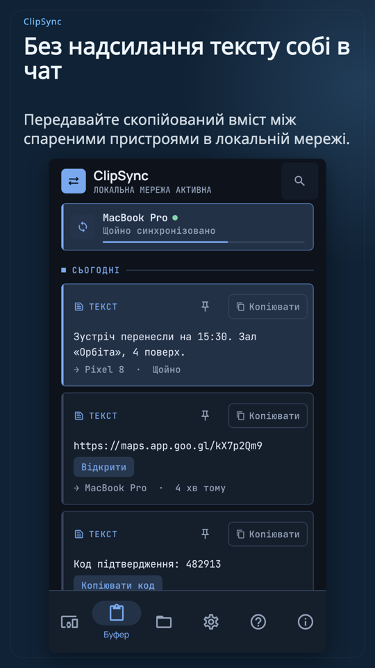
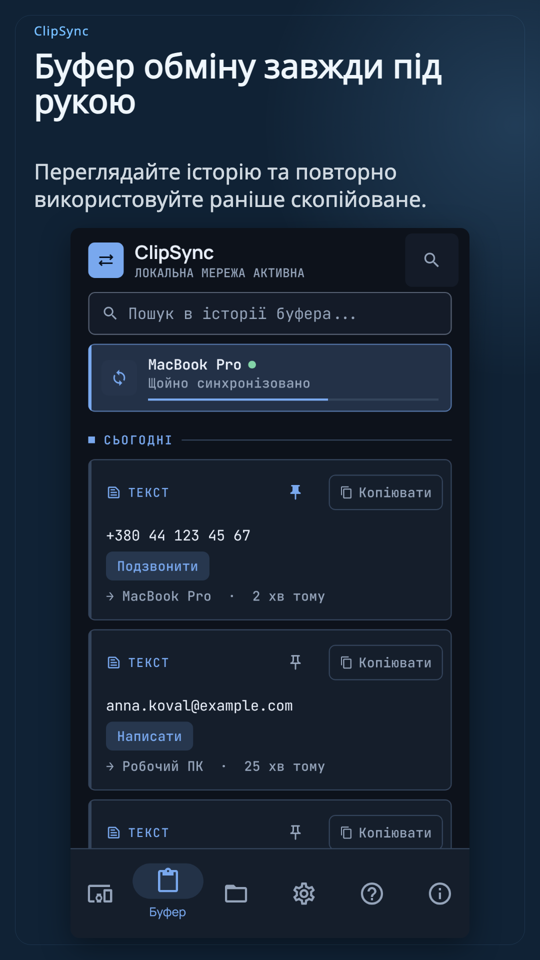
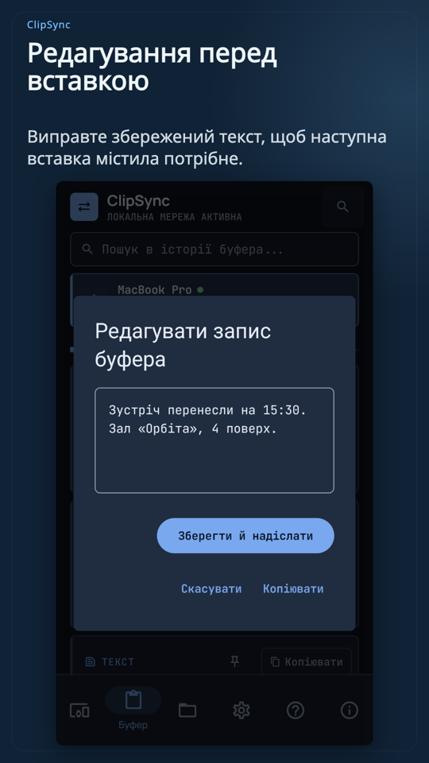
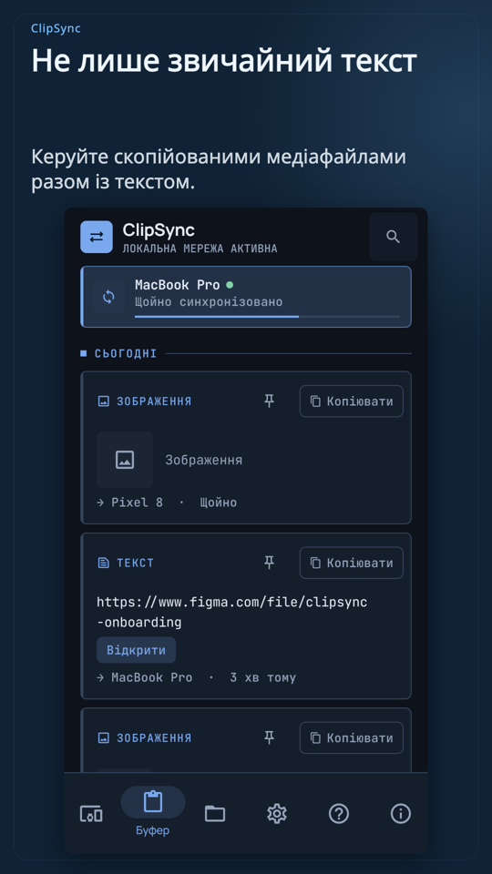

  

<h1 align="center">ClipSync</h1>

  <b>Ваш Android‑телефон на Linux, Windows і macOS — через власний Wi‑Fi.</b> 
  Буфер обміну · файли · сповіщення · дзвінки · музика · фото · трансляція екрана. 
  Без акаунта. Без хмари. Без реклами.

  <a href="https://osvald-studio.com/clipsync">Сайт</a> ·
  <a href="https://osvald-studio.com/download">Завантажити</a> ·
  <a href="https://osvald-studio.com/buy">Купити раз — $19</a> ·
  <a href="docs/INSTALL.md">Установка й активація (EN)</a> ·
  <a href="docs/FAQ.md">FAQ (EN)</a> ·
  <a href="README.md">English</a>

  

---

## Що вміє

| | |
|---|---|
| **Один буфер на всі пристрої** | Скопіювали на телефоні — вставили на комп’ютері, і навпаки. Текст, форматований текст, посилання, зображення. Працює з **кількома** спареними пристроями одночасно. |
| **Файли в обидва боки** | Поділіться з будь‑якого застосунку Android, киньте файл на комп’ютері. Передача відновлюється після обриву і звіряється SHA‑256. |
| **Секрети** | Паролі з менеджера паролів передаються як *секрети*: лише в пам’яті, не потрапляють в історію, зникають із буфера через 45 с. |
| **Сповіщення на комп’ютері** | Сповіщення телефона на Linux, Windows чи Mac: відповідайте, натискайте дії, закривайте. |
| **Дзвінки** | Бачите, хто дзвонить; відповідайте, відхиляйте чи завершуйте з комп’ютера; набирайте з посилань `tel:`. Звук лишається на телефоні. |
| **Керування музикою в обидва боки** | Пауза / далі для того, що грає на телефоні, і керування Spotify чи MPRIS‑плеєрами на комп’ютері з телефона. |
| **Фото з телефона на великому екрані** | Переглядайте й зберігайте галерею телефона з комп’ютера. |
| **Трансляція екрана** | Екран телефона у вікні, зі звуком, і за бажанням керування мишею та клавіатурою. |
| **Знайти телефон · Відкрити посилання на іншому пристрої** | Телефон дзвонить навіть у беззвучному режимі; посилання відкривається на іншому пристрої. |

     

## Платформи

| Android | Linux | Windows | macOS |
|---|---|---|---|
| Android 8.0+ (APK, сервіси Google не потрібні) | AppImage / .deb, трей, автозапуск, MPRIS | Інсталятор / portable | Застосунок у рядку меню, macOS 13+ |

Пристрої знаходять одне одного в локальній мережі (Bonjour / DNS‑SD і UDP‑запит) і показуються за назвами.
Потрібна одна Wi‑Fi мережа — сервера‑посередника немає навмисно.

## Приватність і безпека

- Без акаунта, без сервера посередині, без аналітики й телеметрії.
- Спарювання показує **6‑значний код на обох екранах** (SAS); підтверджуйте лише однакові коди.
- Усе між пристроями зашифровано наскрізно для кожної пари (ECDH P‑256 + AES‑256‑GCM). Трансляція екрана має окремий ключ на сеанс.
- Ключі зберігаються в Android Keystore, macOS Keychain, Windows DPAPI або Linux Secret Service.
- У логах ніколи немає вмісту буфера, тексту сповіщень, номерів телефонів чи назв секретних файлів.

## Ціна

ClipSync можна спробувати безкоштовно. Один ключ — **$19, оплата один раз** — відкриває всі функції на **всіх ваших пристроях** (до 5) назавжди. Оплата в USDC у мережі Base, без картки й без акаунта. Купити на [сайті](https://osvald-studio.com/buy); ключ з’являється одразу після підтвердження платежу.

Безкоштовно: текст і посилання з одним спареним пристроєм, спарювання з кодом. 7 днів повного пробного періоду після першого спарювання.

## Установка й активація

Див. [docs/INSTALL.md](docs/INSTALL.md): Android (APK, Huawei без сервісів Google, оновлення), Linux (AppImage / .deb, брандмауер), Windows, macOS («Відкрити все одно»), спарювання, введення ключа, перенесення ліцензії на інший пристрій.

## Мови

English, Українська, Polski, Deutsch, Español, Français, Português (Brasil), Italiano, Türkçe, Čeština.

## Підтримка

- [FAQ](docs/FAQ.md)
- Помилки й ідеї — у вкладці **Issues** цього репозиторію (без логів з особистими даними).
- Сторінка підтримки: <https://osvald-studio.com/support>

---

Цей репозиторій — сторінка продукту й документація ClipSync. Вихідний код тут не публікується. © Osvald Studio.
